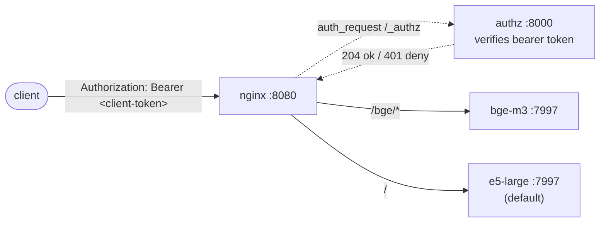

# embedding_infinity_docker

Two [michaelfeil/infinity](https://github.com/michaelfeil/infinity) embedding services
(`BAAI/bge-m3` and `intfloat/multilingual-e5-large`) sitting behind an authenticating nginx
gateway. Clients hit a single host:port, present a bearer token, and get routed to the right
backend by URL prefix.

The Infinity image lives at [`michaelf34/infinity`](https://hub.docker.com/r/michaelf34/infinity)
on Docker Hub (the GitHub user is `michaelfeil`, the Docker Hub user is `michaelf34`).

## Topology



| Service     | Image                                  | Internal port | External surface                                |
| ----------- | -------------------------------------- | ------------- | ----------------------------------------------- |
| `nginx`     | `nginxinc/nginx-unprivileged:alpine`   | `8080`        | `localhost:<random>` (local) / Traefik (server) |
| `authz`     | `python:3.12-alpine`                   | `8000`        | none — only nginx talks to it                   |
| `bge-m3`    | `michaelf34/infinity:*`                | `7997`        | none — proxied via `/bge/*`                     |
| `e5-large`  | `michaelf34/infinity:*`                | `7997`        | none — proxied via `/`                          |

The model containers share a named Docker volume (`infinity-hf-cache`) for the Hugging Face cache
so they don't double-download tokenizers and configs.

## Two profiles, one repo

| File                          | Purpose                                | Device | Dtype     |
| ----------------------------- | -------------------------------------- | ------ | --------- |
| `docker-compose.yml`          | Local dev on a laptop                  | CPU    | float32   |
| `docker-compose.server.yml`   | GPU override layered onto the base     | CUDA   | float16   |

The server file is an **override**, not a standalone stack — it patches `command:`, adds the
`deploy.resources` GPU reservation, drops published ports, and switches the gateway to Traefik
HTTPS routing. Always pass both files when running on the server.

## Authentication

Single-key model, enforced at the gateway:

- **Client tokens** live in `.docker/authz/api_keys.txt`, one per line — `<token> # <label>`.
  The `authz` sidecar re-reads the file on every request, so adding or revoking tokens is live;
  no container restart needed.
- The Infinity upstreams are **not** configured with their own API key. They're only reachable
  on the internal `app` Docker network, so nginx is the sole authenticator and the client's
  `Authorization` header is forwarded upstream as-is.

Missing or unknown client token → `authz` returns 401 → nginx blocks the request.

## Prerequisites

- Docker Engine ≥ 24 with the Compose v2 plugin
- **Server only:** NVIDIA driver + [`nvidia-container-toolkit`](https://docs.nvidia.com/datacenter/cloud-native/container-toolkit/latest/install-guide.html)
  (verify with `docker run --rm --gpus all nvidia/cuda:12.4.0-base-ubuntu22.04 nvidia-smi`)
- The external `frontend` Docker network must exist:
  ```bash
  docker network create frontend
  ```
- An `api_keys.txt` with at least one client token (see *First-time setup* below) — the file
  *must* exist before `up -d` or Docker bind-mounts a directory and every request 500s.
- Disk: ~5 GB for combined model weights in `infinity-hf-cache`
- Server VRAM: target deployment is a **single 16 GB GPU** shared by both services. Steady-state
  fp16 footprint is ~7–10 GB; peaks under long bge-m3 inputs (8 k-token context) can reach
  ~12–13 GB at the default batch sizes (`bge-m3=16`, `e5-large=32`). Raise batch sizes
  cautiously and watch `nvidia-smi` for the first heavy run.

## First-time setup

```bash
cp .env.example .env
$EDITOR .env                                                      # set COMPOSE_DOMAIN, COMPOSE_SERVER_DOMAIN, INFINITY_IMAGE_VERSION, etc.

cp .docker/authz/api_keys.txt.example .docker/authz/api_keys.txt
echo "tok_$(openssl rand -hex 16) # alice <alice@example.com>" >> .docker/authz/api_keys.txt
```

## Run — local (CPU)

```bash
docker compose pull
docker compose up -d
docker compose logs -f
```

CPU inference is slow on these models (seconds-per-request, not ms). It's a smoke-test path —
fine for wiring up clients, not for load.

The nginx port is published as `"8080"` without a host binding, so Docker assigns a random host
port:

```bash
docker compose port nginx 8080      # e.g. 0.0.0.0:49154
```

Use that, or point a local Traefik at `${COMPOSE_DOMAIN}`.

## Run — server (GPU)

```bash
docker compose -f docker-compose.yml -f docker-compose.server.yml pull
docker compose -f docker-compose.yml -f docker-compose.server.yml up -d
docker compose -f docker-compose.yml -f docker-compose.server.yml logs -f
```

To make the GPU stack the default for every `docker compose` invocation in this directory, add to
`.env`:

```
COMPOSE_FILE=docker-compose.yml:docker-compose.server.yml
```

…then `docker compose up -d` / `down` / `logs` work without the `-f` flags.

On the server every published port is dropped (`!reset []`) and traffic enters via Traefik on
`${COMPOSE_SERVER_DOMAIN}` with HTTPS-redirect from `web` → `websecure`.

## Calling the API

The path prefix selects the model; `model:` in the request body is informational (Infinity
matches by served-model-name).

```bash
TOKEN="tok_abc123"                          # from .docker/authz/api_keys.txt
HOST="http://localhost:$(docker compose port nginx 8080 | cut -d: -f2)"
# On the server: HOST="https://${COMPOSE_SERVER_DOMAIN}"

# e5-large (default at /)
curl -sS "$HOST/v1/embeddings" \
  -H "Authorization: Bearer $TOKEN" \
  -H 'Content-Type: application/json' \
  -d '{"model":"multilingual-e5-large","input":["query: hvad er en vektor?"]}'

# bge-m3 (under /bge prefix)
curl -sS "$HOST/bge/v1/embeddings" \
  -H "Authorization: Bearer $TOKEN" \
  -H 'Content-Type: application/json' \
  -d '{"model":"bge-m3","input":["hej fra Aarhus","hello from Aarhus"]}'
```

### BGE-M3 sparse + ColBERT vectors

`bge-m3` natively produces three representations. `/v1/embeddings` returns **dense** only — for
the other two, hit Infinity's native routes under the same `/bge/` prefix:

```bash
# Sparse / lexical weights (token_id -> weight)
curl -sS "$HOST/bge/embeddings_sparse" \
  -H "Authorization: Bearer $TOKEN" \
  -H 'Content-Type: application/json' \
  -d '{"model":"bge-m3","input":["hej fra Aarhus"]}'

# ColBERT / multi-vector (one vector per token)
curl -sS "$HOST/bge/embeddings/colbert" \
  -H "Authorization: Bearer $TOKEN" \
  -H 'Content-Type: application/json' \
  -d '{"model":"bge-m3","input":["hej fra Aarhus"]}'
```

Endpoint paths follow the running Infinity version — `docker compose exec bge-m3 wget -qO-
http://localhost:7997/openapi.json` shows the live spec.

## Operations

```bash
# Status — all four services should be healthy
docker compose ps

# Inspect token verdicts (204 ok / 401 deny, with client IP and label)
docker compose logs -f authz

# Internal probes
docker compose exec authz python -c \
  "import urllib.request; print(urllib.request.urlopen('http://localhost:8000/healthz').status)"
docker compose exec nginx wget -qO- http://localhost:8080/v1/models   # proxied to e5-large

# Restart one piece without restarting the rest
docker compose restart bge-m3
docker compose restart nginx                                          # picks up template edits

docker compose down                       # stop, keep cache volume
docker compose down -v                    # stop AND wipe HF cache
```

## Tuning

- **Two GPUs** (not the current server): set `BGE_M3_GPU=0` and `E5_LARGE_GPU=1` in `.env`.
  On the production server (single 16 GB card) leave both at `0`.
- **Batch sizes**: defaults are CPU 8/8, GPU 16/32 (bge-m3 is conservative because of its
  8 k-token context). Pin `BGE_M3_BATCH_SIZE` / `E5_LARGE_BATCH_SIZE` in `.env` to override.
- **Quantisation**: change `--dtype=float16` to `int8` in `docker-compose.server.yml` to roughly
  halve VRAM at a small accuracy cost.
- **Pin the image**: replace `michaelf34/infinity:latest` with a tagged release for reproducible
  builds.
- **Token rotation**: edit `.docker/authz/api_keys.txt` and the next request will see the new
  set — no restart, no reload signal.
